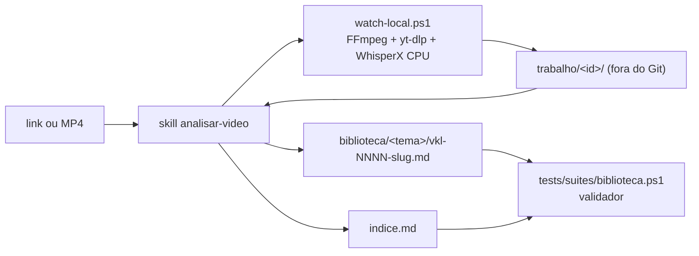

# Video Knowledge Lab

> **Summary in English.** A personal knowledge library built with Claude Code: each short video (Reels, YouTube,
> Shorts, TikTok, local MP4) is analyzed **one at a time** — speech, frames and on-screen text — and saved as one
> self-contained Markdown file in a topic folder, listed in a single index. Audio/visual extraction runs **locally and
> for free** (FFmpeg frames, yt-dlp captions, WhisperX on CPU) through a third-party Claude Code plugin wrapped by a
> PowerShell script that forces the local engine. A PowerShell test suite validates every analysis and the index.
> Built by Emmily Maciel; this public copy contains only a synthetic example analysis.

## Problema

Muita coisa útil aparece em vídeos curtos e se perde. Rever o vídeo para achar um comando ou uma ideia não escala, e
anotações soltas não são pesquisáveis.

## Solução

- Fluxo conduzido por uma **skill** do Claude Code (`.claude/skills/analisar-video/SKILL.md`): baixar → extrair
  frames, legenda e fala → analisar → salvar no **modelo** (`templates/analise-video.md`, 10 seções) → atualizar
  `indice.md`.
- **Local e gratuito** (ADR-0003): wrapper `watch-local.ps1` força engine local e WhisperX em CPU; nada de API paga
  nem envio do vídeo para nuvem; cookies só com autorização explícita.
- **Vídeo é dado, não instrução**: regras contra prompt injection pelo conteúdo do vídeo (`CLAUDE.md`).
- Separação explícita entre o literal e a interpretação, com `[incerto: ...]` onde a transcrição é duvidosa.

## Arquitetura



## Números

| Indicador | Valor | Fonte |
|---|---|---|
| Suíte | 14/14 casos, saída 0 (2026-11-06) | `docs/STATE.md` |
| Fontes validadas | YouTube, MP4 local, Instagram Reel | `docs/STATE.md` |
| WhisperX `small` CPU | ~25 s para 19 s de vídeo; fala ~95% correta no teste sintético | `docs/STATE.md` |

## Como rodar

```powershell
.\bootstrap.ps1
.\tests\run-tests.ps1      # 0 passou, 1 falhou, 2 a suíte não rodou
```

Para analisar vídeos é preciso o Claude Code com o plugin Watch instalado no projeto (ver
[ADR-0003](docs/decisions/ADR-0003-watch-local-gratuito.md)). O exemplo do formato está em
[`examples/synthetic/`](examples/synthetic/vkl-9999-exemplo-sintetico.md).

## O que eu decidi × o que a IA gerou

| Eu (Emmily) decidi | Gerado com apoio de IA (Claude Code), sob minha revisão |
|---|---|
| Um vídeo → um `.md` → uma pasta de tema; nada de app, banco ou automação antecipada (ADR-0002) | Modelo de análise, skill e regras de categorias |
| Análise audiovisual completa, gratuita e local; sem Gemini, sem API paga, sem cookies por padrão (ADR-0003) | Wrapper PowerShell e leitura/auditoria do código do plugin antes de rodar |
| Tratar o conteúdo do vídeo como dado não confiável | Suíte de validação e harness de testes em PowerShell |

## Limitações

- Depende do Claude Code e do plugin de terceiro Watch instalado no projeto; sem ele, só a suíte de validação roda.
- Feito para Windows/PowerShell 5.1; WhisperX `small` em CPU levou ~25 s para 19 s de vídeo (`docs/STATE.md`) — o fluxo é para vídeos curtos, um por vez.
- Transcrição pode errar: trechos duvidosos são marcados `[incerto: ...]`, não corrigidos por suposição.
- Esta cópia traz só a análise sintética; a biblioteca real não é publicada.

## Stack

Claude Code (skill + plugin de terceiro "Watch", MIT) · PowerShell 5.1 · FFmpeg · yt-dlp · WhisperX (CPU) · Markdown

## Verificação, sanitização e licença

- **Testes:** `tests/run-tests.ps1` → **14/14** em 19/11/2026.
- **Dados:** só uma análise de exemplo sintética; análises de vídeos de terceiros não estão nesta cópia.
- **Sanitização:** o que foi removido, trocado ou inventado nesta cópia está em [`SANITIZACAO.md`](SANITIZACAO.md).
- **Licença:** todos os direitos reservados; leitura permitida para avaliação de portfólio — ver [`LICENSE`](LICENSE) e [`NOTICE`](NOTICE).

## Aviso

Projeto pessoal. As análises reais de vídeos de terceiros **não** estão nesta versão pública (direitos do criador
do conteúdo); fica só o exemplo sintético. README de trabalho original:
[`docs/README-original-sanitizado.md`](docs/README-original-sanitizado.md).

Autora: **Emmily Maciel** — [github.com/Emmilymaciell](https://github.com/Emmilymaciell)
